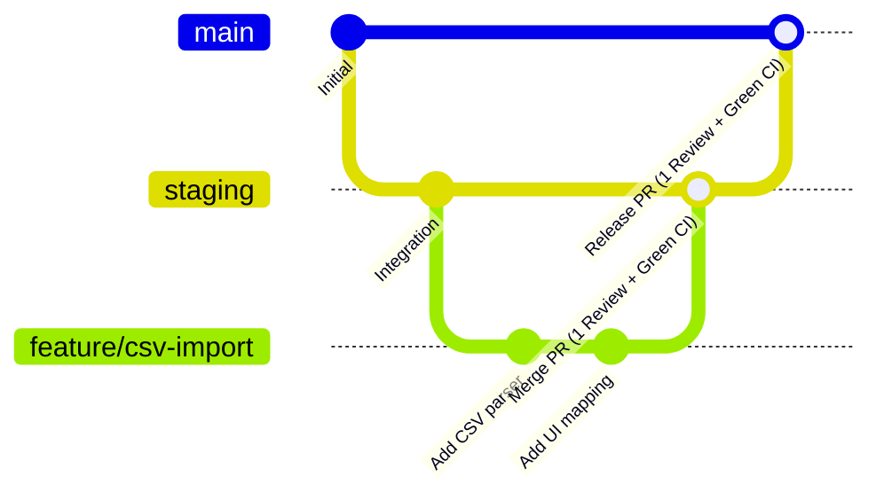

# 🤝 Contributing to PartnerForge

Thank you for contributing to **QUT PartnerForge**! To maintain code quality, system stability, and smooth team collaboration, all team members and contributors are required to adhere to the engineering guidelines, branching model, and branch protection rules outlined in this document.

---

## 🌳 1. Branching Strategy

Our repository operates on a structured multi-branch workflow:



### Core Branches
1. **`main`** *(Protected)*:
   - Contains production-ready, release-quality code.
   - **Direct pushes are strictly prohibited.**
   - All code must arrive via a Pull Request with **at least 1 approving review** and **passing CI status checks**.
2. **`staging`** *(Protected)*:
   - Primary integration branch where new features and bug fixes are integrated and tested on the hosted preview environment.
   - Deploys automatically to the staging environment.
   - **Direct pushes are prohibited.** Merges require 1 approving review and green CI checks.

### Supporting / Working Branches
Always branch off the latest `main` (or `staging` as designated for the sprint):
- **`feature/<short-description>`**: New features, UI enhancements, or schema additions (e.g. `feature/csv-upload`, `feature/dynamic-filter`).
- **`fix/<short-description>`**: Bug fixes and corrective patches (e.g. `fix/intake-summary-view`).
- **`devops/<short-description>`**: CI/CD pipelines, Docker configurations, deployment scripts, or repo governance (e.g. `devops/branch-protection`).
- **`chore/<short-description>`**: Dependency upgrades, linting, or housekeeping.

---

## 🛡️ 2. Branch Protection Rules

In accordance with Phase 1 and Phase 2 governance commitments, the following protection rules are strictly enforced for both `main` and `staging`:

| Rule | Requirement | Enforcement |
| :--- | :--- | :--- |
| **Require Pull Request** | Yes | All changes must be submitted via a Pull Request. Direct pushes are rejected by GitHub. |
| **Required Approving Reviews** | **Minimum 1** | Merging is blocked until at least one team member reviews and approves the PR. |
| **Dismiss Stale Approvals** | Enabled | New commits pushed to an open PR invalidate previous approvals, requiring re-review. |
| **Require Status Checks (CI)** | **Green CI Required** | All automated tests and builds (`frontend-ci` & `backend-ci`) must pass before merge. |
| **Require Up-to-Date Branches** | Enabled | PR branches must be rebased or merged with target branch before merging. |
| **Block Force Pushes** | Enabled | `git push --force` is rejected on protected branches to preserve linear audit history. |
| **Block Branch Deletion** | Enabled | Prevents accidental deletion of protected branches. |

---

## 🔄 3. Pull Request & Review Process

### Creating a Pull Request
1. **Sync Local Branch**:
   ```bash
   git checkout main
   git pull origin main
   git checkout feature/your-feature-name
   git merge main  # or git rebase main
   ```
2. **Push to Remote**:
   ```bash
   git push -u origin feature/your-feature-name
   ```
3. **Open Pull Request**:
   - Use the standard PR template (`.github/pull_request_template.md`).
   - Title must follow [Conventional Commits](#-4-commit-message-conventions) (e.g. `feat(csv): add interactive header mapping`).
   - Link the relevant issue in the description (e.g. `Closes #11`).
   - Fill out the **Verification & Testing Checklist**.

### Code Review Guidelines
- **Turnaround Expectation**: Review assigned PRs within 24 hours to prevent sprint blockers.
- **Review Criteria**:
  - Code correctness and alignment with acceptance criteria.
  - Test coverage (unit tests included and passing).
  - Security (no hardcoded credentials, proper RBAC permission checks).
  - Database hygiene (schema migrations and model consistency).

---

## 📝 4. Commit Message Conventions

We follow the **Conventional Commits** specification:

```
<type>(<optional scope>): <short description in imperative mood>

[optional body explaining rationale]

[optional footer(s), e.g., Closes #11]
```

### Supported Types
- `feat`: A new feature for the user or system.
- `fix`: A bug fix.
- `refactor`: Code change that neither fixes a bug nor adds a feature.
- `test`: Adding or correcting unit/integration tests.
- `devops` / `ci`: Changes to CI/CD workflows, build tools, or repository governance.
- `docs`: Documentation only changes.
- `chore`: Dependency updates, formatting, or project maintenance.

*Example:* `feat(csv-import): add interactive column mapping and address auto-splitting`

---

## 🧪 5. Local Quality Verification Before Opening a PR

Before submitting your PR, verify that all local checks pass cleanly:

### Frontend Checks (Next.js & TypeScript)
```bash
cd frontend

# 1. Run unit test suite
npm test

# 2. Run TypeScript typecheck
npm run type-check

# 3. Verify production build
npm run build
```

### Backend Checks (.NET & C#)
```bash
# 1. Restore & Build API
dotnet build api/Qut.PartnerForge.Api/Qut.PartnerForge.Api/Qut.PartnerForge.Api.csproj

# 2. Run Backend Unit Tests
dotnet test api/Qut.PartnerForge.Api/Qut.PartnerForge.Api.Tests/Qut.PartnerForge.Api.Tests.csproj
```

---

## ⚙️ 6. Repository Admin Setup (GitHub Branch Protection Settings)

For repository administrators configuring branch protection on GitHub:

1. Go to **Settings** $\rightarrow$ **Rules** $\rightarrow$ **Rulesets** (or **Branches** $\rightarrow$ **Branch protection rules**).
2. Create a ruleset named `Protect Main and Staging`:
   - **Target branches**: Include `main` and `staging`.
   - **Rules**:
     - ✅ **Restrict deletions**: Enabled.
     - ✅ **Block force pushes**: Enabled.
     - ✅ **Require a pull request before merging**:
       - Required approvals: `1`.
       - Dismiss stale pull request approvals when new commits are pushed: `Enabled`.
       - Require review from Code Owners: Optional.
     - ✅ **Require status checks to pass**:
       - Status check: `Frontend CI (Next.js & Vitest)`
       - Status check: `Backend CI (.NET & Tests)`
       - Require branches to be up to date before merging: `Enabled`.
3. Save and enforce the ruleset.
