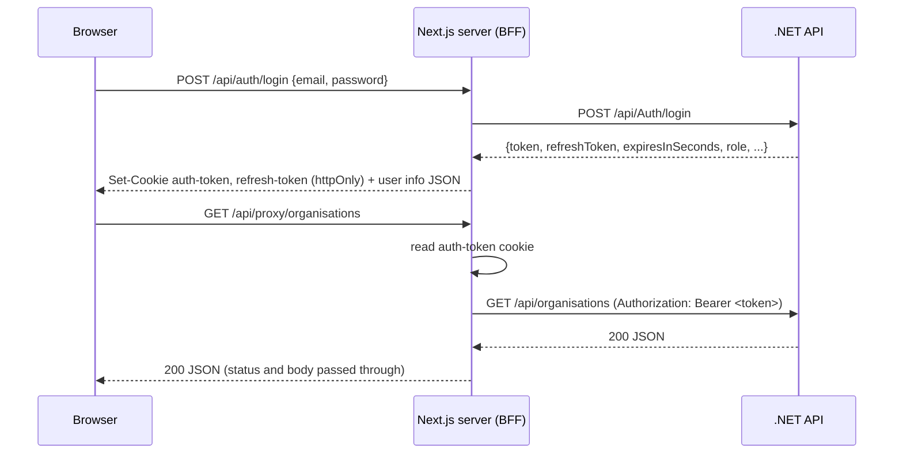
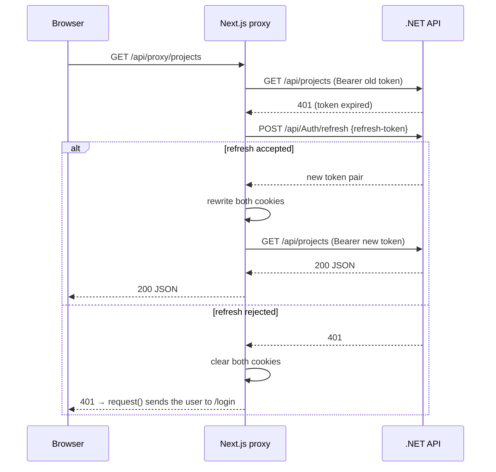

# Frontend Architecture

How the PartnerForge Next.js frontend is put together, so anyone on the team can work on it
without needing the original author. Covers the auth flow, route structure, the core shared
components, and the conventions to follow.

> Written against `main` at `23ea0b1`. Changes still in open PRs are listed in
> [Pending changes](#6-pending-changes) at the end; update this doc when they merge.

---

## 1. Stack and layout

- **Next.js 16** (App Router), **React 19**, **TypeScript**
- No UI library; icons from `lucide-react`; CSV parsing with `papaparse`
- Tests with **Vitest** (`npm test`); `npm run type-check` and `npm run build` must pass before a PR (see `CONTRIBUTING.md`)
- `next.config.ts` uses `output: "standalone"` for the Docker image
- Import alias: `@/` = `frontend/` (e.g. `import { request } from "@/lib/api"`)

```
frontend/
├── middleware.ts                    # Redirects logged-out users to /login (edge)
├── app/
│   ├── layout.tsx                   # Root layout, imports globals.css
│   ├── page.tsx                     # "/" → redirect("/dashboard")
│   ├── login/                       # Public login page
│   ├── (authenticated)/             # Route group: every page here needs a session
│   │   ├── layout.tsx               # AuthProvider + AuthGate + Header
│   │   ├── dashboard/
│   │   ├── platform/                # Organisations / Projects / Events / Users (?view=…)
│   │   ├── analytics/
│   │   └── audit-log/
│   └── api/                         # Server-side route handlers (the BFF)
│       ├── auth/login|logout|refresh|session/route.ts
│       └── proxy/[...path]/route.ts # Forwards every data call to the .NET API
├── components/                      # Shared UI: FilterBuilder, DataTable, RecordModal, Header, charts/
├── lib/
│   ├── api.ts                       # request() — the client-side fetch helper
│   ├── api/search.ts                # Typed client for /api/search/*
│   ├── api/analytics.ts             # Typed client for /api/analytics/*
│   ├── auth-context.tsx             # AuthProvider / useAuth()
│   ├── auth-cookies.ts              # Cookie names, set/clear, refreshAccessToken()
│   └── permissions.ts               # Role → permission matrix, canCreate/canEdit/canDelete
├── helper/upload-core.ts            # CSV import logic (column mapping, validation)
└── tests/                           # Vitest tests
```

---

## 2. Auth flow

The browser **never sees a token**. Both tokens live in `httpOnly` cookies that client-side
JavaScript cannot read. All data calls go through a Next.js route handler that attaches the
token server-side; this is the Backend-for-Frontend (BFF) pattern.



### Cookies (`lib/auth-cookies.ts`)

| Cookie | Holds | Lifetime |
|---|---|---|
| `auth-token` | Access JWT | Same as the token (`expiresInSeconds`, fallback 900 s) |
| `refresh-token` | Single-use refresh token | 14 days (matches `Jwt:RefreshTokenExpiryInDays` on the API) |

Both are `httpOnly`, `sameSite: "lax"`, `path: "/"`, and `secure` in production.
Because the access cookie expires with its token, **"access cookie missing but refresh
cookie present" is the normal state of an idle session**, not an error.

### Route handlers (`app/api/`)

| Route | What it does |
|---|---|
| `POST /api/auth/login` | Calls the API, sets both cookies, returns `{fullName, email, role, facultyId, organisationId}`. 401 → "Invalid email or password." |
| `POST /api/auth/logout` | Revokes the refresh token on the API (best effort), then clears both cookies. |
| `POST /api/auth/refresh` | Rotates both cookies via `refreshAccessToken()`. Returns only `{ok}`; tokens never reach the client. |
| `GET /api/auth/session` | Decodes the access JWT (refreshing first if needed) and returns the user's name, email, role, faculty and organisation. This is how the client learns who is logged in. |
| `* /api/proxy/[...path]` | Forwards any method to `${BACKEND_URL}/api/<path>` with the query string and body, adding `Authorization: Bearer`. |

### Token refresh

`refreshAccessToken()` swaps the refresh token for a new pair and rewrites both cookies.

- **API rejects the refresh** → both cookies are cleared (the token is single-use, so a rejected one is spent).
- **API unreachable** → cookies are kept, so a short outage doesn't log everyone out.

The proxy refreshes in two places:
1. Before the call, if `auth-token` is missing.
2. After the call, if the API returns **401**. It refreshes **once** and retries **once**; a second 401 clears the cookies and returns 401.



### Backend URL

`BACKEND_URL` env var, default `http://localhost:8080`. In Docker Compose it is
`http://api:8080`. If you run the API with `dotnet run` (port 5133), set `BACKEND_URL`.
See `docs/configuration.md`.

### Client side

- **`lib/api.ts` → `request<T>(path, options)`**: the helper pages should use. It calls
  `/api/proxy${path}`, sends you to `/login` on 401, throws `Error("HTTP <status>")` on other
  errors, and returns `null` for 204.
  - Note: it always sets `Content-Type: application/json`, so it is **not suitable for file
    uploads** (`FormData`). The CSV import uses a server action instead (see `helper/upload.ts` below).
- **`lib/auth-context.tsx` → `AuthProvider` / `useAuth()`**: calls `/api/auth/session` on
  mount and exposes `{ user, loading, logout, refreshSession }`. `user.role` is lower-case
  (e.g. `course_organiser`).

---

## 3. Route structure and protection

### `(authenticated)` route group

The parentheses mean the folder name is **not part of the URL**: `app/(authenticated)/dashboard/page.tsx`
is served at `/dashboard`. The group exists so all protected pages share one layout,
`app/(authenticated)/layout.tsx`, which wraps them in:

```
<AuthProvider>      // loads the session
  <AuthGate>        // loading or no user → skeleton screen, then router.push("/login")
    <Header />
    {page}
  </AuthGate>
</AuthProvider>
```

| URL | Page | Notes |
|---|---|---|
| `/` | `app/page.tsx` | Redirects to `/dashboard` |
| `/login` | `app/login/page.tsx` | Public |
| `/dashboard` | `(authenticated)/dashboard` | |
| `/platform?view=partners\|projects\|events\|users` | `(authenticated)/platform` | One page, view picked by the `view` query param |
| `/analytics` | `(authenticated)/analytics` | Hidden in nav for roles with `analytics: "no"` |
| `/audit-log` | `(authenticated)/audit-log` | Admin only (nav) |

### Two layers of protection

1. **`middleware.ts` (edge, before the page loads)**: runs only for paths in
   `config.matcher` (`/dashboard`, `/platform`, `/analytics`, `/audit-log`).
   - Valid, unexpired `auth-token` → continue.
   - Missing/expired token **but** a `refresh-token` exists → continue. Middleware can't call
     the API, so it lets the request through and the session/proxy routes renew the token.
   - Neither → redirect to `/login`.
2. **`AuthGate` (client)**: if `/api/auth/session` returns 401, `user` is `null` and the
   gate redirects to `/login`.

> **Adding a protected page:** put it under `app/(authenticated)/` **and** add its path to
> `config.matcher` in `middleware.ts`. If you skip the matcher, the page still gets
> `AuthGate`, but logged-out users see a flash of skeleton before the redirect.

### Role-based UI

`lib/permissions.ts` holds the role → permission matrix (`rw` / `r` / `no`) for the five roles
(`admin`, `course_organiser`, `industry_partner`, `industry_team`, `industry_team_manager`), plus
`canCreate`, `canEdit`, `canDelete` and `prettyRole`. These only **hide UI**; the API enforces
the real authorisation. Keep the matrix in sync with the API's policies.

---

## 4. Core components

### `FilterBuilder` (`components/FilterBuilder.tsx`)

A filter panel for any searchable entity. It loads what can be filtered from the API, lets the
user build conditions, runs the search, and hands the results to the parent (usually to show
in a `DataTable`).

**Props**

| Prop | Type | Purpose |
|---|---|---|
| `entity` | `string` | Entity name used in the URL, e.g. `"organisations"` |
| `onResults` | `(data: SearchResponse<T>) => void` | Receives each page of results |
| `onRequestChange?` | `(req: SearchRequest) => void` | Sees each request sent (e.g. for export) |
| `pageSize?` | `number` | Default 25 |
| `sortBy?`, `sortDirection?` | `string \| null`, `"asc" \| "desc"` | Passed straight to the API |
| `page?`, `onPageChange?` | `number`, `(p) => void` | Lets the parent control paging (e.g. DataTable Next/Previous) |
| `refreshKey?` | `number` | Increment after create/edit/delete to re-run the search and reload field options |

**Contract with `/api/search`** (via `lib/api/search.ts`)

| Call | Endpoint | Returns |
|---|---|---|
| `fetchFilterableFields(entity)` | `GET /search/fields/{entity}` | `[{ field, label, type, options? }]`, type ∈ `text \| number \| select \| date` |
| `fetchRelationships(entity)` | `GET /search/relationships/{entity}` | `[{ entity, label }]`: tables usable in cross-table conditions |
| `searchEntity(entity, req)` | `POST /search/{entity}` | `{ total, items, page, pageSize }` |
| `fetchSavedFilters(entity)` | `GET /search/saved-filters/{entity}` | `[{ id, name, entity, filters (JSON string), createdAt }]` |
| `createSavedFilter(...)` | `POST /search/saved-filters` | The saved filter |
| `deleteSavedFilter(id)` | `DELETE /search/saved-filters/{id}` | 204 |

(Paths are relative to `/api/proxy`, so the API sees `/api/search/...`.)

Search request body:

```json
{
  "filters": [
    { "field": "partnershipStatus", "operator": "equals", "value": "active" }
  ],
  "relatedFilters": [
    {
      "entity": "projects",
      "quantifier": "any",
      "filters": [{ "field": "year", "operator": "greaterThan", "value": "2024" }]
    }
  ],
  "sortBy": null,
  "sortDirection": "asc",
  "page": 1,
  "pageSize": 25
}
```

- Operators by field type: `text` → `equals`, `contains`; `number` → `equals`, `greaterThan`,
  `lessThan`; `select` → `equals`; `date` → `equals` (on), `greaterThan` (after), `lessThan` (before).
- `quantifier`: `"any"` = at least one related row matches, `"none"` = no related row matches.
- Values are always sent as strings. Rows with no field or an empty value are dropped.
- The response mapper also accepts `data` instead of `items`, for older endpoints.

**Behaviour to know about**
- **Auto-apply**: conditions run 400 ms after the user stops typing; "Apply filters" runs immediately.
- **Stale responses are ignored** (`searchSeqRef` counter), so a slow earlier search can't overwrite a newer one.
- A saved filter's `filters` field is a JSON string, either a plain `FilterItem[]` (old format) or `{ filters, relatedFilters }`. Both load correctly.
- After a delete empties the last page, `refreshKey` steps back to the new last page.

### `DataTable` (`components/DataTable.tsx`)

Generic table with paging. **It does not sort or filter**; that's FilterBuilder or the API's job.

| Prop | Purpose |
|---|---|
| `columns: Column<T>[]` | `{ key?, label, render?, width? }`: `render(row)` for custom cells, otherwise `row[key]` as text |
| `data` / `rows` | The rows (either name works) |
| `total`, `page`, `pageSize`, `onPageChange` | Footer "Showing x–y of N" + Previous/Next. Footer only shows when `onPageChange` is passed |
| `emptyMessage` | Shown instead of the table when there are no rows |
| `getRowId`, `expandedRowId`, `renderExpandedRow` | Show a full-width detail row under one row |
| `highlightRowId` | Highlights that row and scrolls it into view (used when jumping from a link elsewhere) |

Also exports `StatusBadge` (renders `<span class="status status-<value>">`) and
`formatDate` (en-AU, e.g. "3 Mar 2026").

### `RecordModal` (`components/RecordModal.tsx`)

One modal for viewing, creating and editing any record. The form is driven by a field list:

```ts
type FieldDef = [name, label, inputType, required, options?];
// e.g. ["partnershipStatus", "Status", "select", true, ["prospect", "active", "inactive"]]
```

`inputType` is any HTML input type, or one of `textarea`, `select` (needs `options`),
`select-org`, `select-org-empty` (adds "No organisation"), `select-industry`, `password`.

- Existing records open in **view mode** first; **Edit** switches to the form. New records
  (`isNew`) open straight in the form.
- On submit it reads the form, converts types (`industryId`, `facultyId`, `year`, ... → number
  or `null`; `isActive`, `multipleTeams` → boolean; empty `password` → `null`) and calls
  `onSubmit(data)`. **Saving to the API is the parent's job.**
- `tableName` + `canViewHistory` add a **History** tab (`AuditHistoryPanel`).
- `peekMode` makes a read-only quick look opened from another table, with a link
  (`peekLinkLabel`, `onPeekNavigate`) instead of Edit.
- Validation today is only the browser's `required` attribute (see issue #50).

### `Header` (`components/Header.tsx`)

Top bar: logo, nav links, user name/email/role badge, Sign out. Reads `useAuth()`, so it only
works inside `AuthProvider`. Nav items depend on role: Analytics is hidden when the role's
`analytics` permission is `"no"`; User Management and Audit Log are admin-only. The active
link is worked out from `usePathname()` and the `?view=` param. It uses `useSearchParams()`,
which is why the layout wraps it in `<Suspense>`.

### Other components and helpers

| File | What it is |
|---|---|
| `components/AuditHistoryPanel.tsx` | The History tab inside `RecordModal`. Loads `GET /auditlog?tableName=…&recordId=…&pageSize=50` and lists who changed what. |
| `components/charts/` | `RankedBarChart` and `StackedBarChart` used on `/analytics`, plus shared colours in `palette.ts`. Each chart takes a `caption` for screen readers. |
| `lib/api/analytics.ts` | Typed wrappers around `request()` for `/analytics/summary`, organisation stats, intakes and most active partners. |
| `helper/upload.ts` | `uploadFileAction`: a **server action** (`"use server"`) for CSV import. It reads `auth-token` itself and posts to the API directly, so it does **not** go through the proxy and does not refresh an expired token. |
| `helper/upload-core.ts` | Pure CSV logic used by the importer: `TABLE_CONFIGS` (which tables can be imported and their fields), `suggestColumnMapping`, `validateCsvForTable`, `parseAddress`, sample/report CSV generators. Tested in `helper/upload.test.ts`. |

---

## 5. Conventions

> This section describes the patterns the existing code follows. They are not formal team
> rules; if you think one should change, raise it with the team.

### Styling

What the code actually does today (main):

| Where | How | Example |
|---|---|---|
| App-wide reset | `app/globals.css` | box-sizing, font |
| One page | Plain `.css` file next to the page, imported in the page | `platform/platform.css` |
| Shared component | **CSS module** (`*.module.css`), `styles.x` | `DataTable.module.css`, `FilterBuilder.module.css` |
| Header | Plain `header.css` (older pattern) | |

- **Tailwind** v4 is installed and wired into PostCSS, but `globals.css` on `main` does not
  `@import "tailwindcss"`, so utility classes do nothing yet. The UI refinement work (#8)
  adds the import and design tokens; follow that once it merges.
- Plain `.css` files are **global**: their class names apply everywhere, so a generic class
  name in one page can affect another. Page-specific prefixes or CSS modules help avoid this.
- Inline `style={{…}}` is mostly used for one-off values (e.g. column widths) and in the
  loading skeleton.

### State

- **Who is logged in**: read from `useAuth()`, which already holds the session, so pages
  don't need to call `/api/auth/session` themselves.
- **Page data**: kept in local `useState` in each page and loaded with `request()` inside
  `useEffect`/`useCallback`. There is currently no global store (no Redux/Zustand/React Query).
- **Which view/tab is shown**: stored in URL query params (`/platform?view=projects`), so links
  and the back button work.
- **After a write**: pages bump a counter (`dataVersion`, `refreshKey`) to reload lists rather
  than patching state by hand.
- **Errors**: pages keep an `error` string in state and render it. `request()` throws
  `Error("HTTP <status>")`, so the message is currently just the status code (see #50).

### Calling the API

- Data calls go through `request()` from `lib/api.ts`, or a typed wrapper in `lib/api/*.ts`
  for a whole feature (`search.ts`, `analytics.ts`).
- The browser does not call the .NET API directly, and tokens are not kept in `localStorage`;
  this is what keeps them out of reach of client-side scripts.
  (`lib/api/search.ts` still has a leftover `getAuthHeaders()` that reads `localStorage`. It
  has no effect, since the proxy sets its own header, and could be removed.)
- Pages that use hooks or state start with `"use client"`.

### Steps for adding a protected page

1. Create `app/(authenticated)/<name>/page.tsx` with `"use client"`.
2. Add `"/<name>/:path*"` to `config.matcher` in `middleware.ts` (easy to forget, see section 3).
3. Add a nav link in `Header.tsx`, gated by `lib/permissions.ts` if role-specific.
4. Put styles in `<name>.css` (prefixed classes) or a CSS module.
5. Run `npm test`, `npm run type-check`, `npm run build`.

---

## 6. Pending changes

Open work that will change parts of this doc. Update the sections listed when it merges.

| Work | What changes | Sections |
|---|---|---|
| #8 / #49 / #50 UI refinement (`feature/ui-refinement-8`) | Adds `Sidebar`, `ConfirmModal`, Tailwind import + design tokens in `globals.css`; RecordModal gets an error banner and async `onSubmit` | 1, 4, 5 |
| #62 / #63 Import/Export (PR #91) | New `/import-export` page; CSV import moves off the dashboard; `lib/navigation.ts`. (As of writing, `/import-export` is not yet in the middleware matcher.) | 1, 3, 4 |
| #40 / #32 Route protection (PR #89) | Session-expiry feedback, role-aware nav | 2, 3 |
